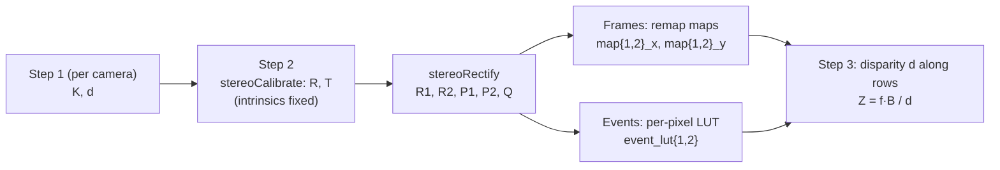

# Stereo rectification with the step 1 and step 2 parameters

This note explains how the two EVK4 cameras are rectified: what each calibration step provides, how the rectification
is computed, how it is applied to images and to events, and how it leads to depth (step 3).
The numbers in the examples come from your calibration files of 2026-11-13:

| File | Content |
|---|---|
| `01_camera_intrincis/output/intrinsics_00050496.json` | Intrinsics of the left camera (step 1) |
| `01_camera_intrincis/output/intrinsics_00051788.json` | Intrinsics of the right camera (step 1) |
| `02_stereo_rectification/output/stereo_00050496_00051788.json` | Extrinsics + rectification (step 2) |
| `02_stereo_rectification/output/stereo_00050496_00051788_<date>/rectification_maps_00050496_00051788.npz` | Look-up tables (step 2) |

---

## 1. What step 1 provides: the intrinsics of each camera

Step 1 calibrates each camera on its own with the blinking chessboard. It estimates the **pinhole camera matrix** `K`
and the **distortion coefficients** `d = (k1, k2, p1, p2, k3)`.

$$
K=\begin{bmatrix} f_x & 0 & c_x\\ 0 & f_y & c_y\\ 0&0&1\end{bmatrix}
$$

A 3D point $(X, Y, Z)$ in the camera frame reaches the sensor in three stages:

1. Ideal projection to normalized coordinates: $x = X/Z,\; y = Y/Z$.
2. Lens distortion (radial `k1, k2, k3`, tangential `p1, p2`), with $r^2 = x^2 + y^2$:

$$
\begin{aligned}
x_d &= x\,(1 + k_1 r^2 + k_2 r^4 + k_3 r^6) + 2p_1 xy + p_2 (r^2 + 2x^2)\\
y_d &= y\,(1 + k_1 r^2 + k_2 r^4 + k_3 r^6) + p_1 (r^2 + 2y^2) + 2p_2 xy
\end{aligned}
$$

3. Conversion to pixels: $u = f_x x_d + c_x,\; v = f_y y_d + c_y$.

Your values (1280×720, 33 of 34 views kept per camera, RMS about 0.37 px):

| Camera | $f_x = f_y$ | $c_x$ | $c_y$ | k1 | k2 | p1 | p2 | k3 |
|---|---|---|---|---|---|---|---|---|
| Left 00050496 | 1630.82 | 666.87 | 352.09 | −0.470 | 0.086 | 0.0010 | 0.0027 | 0.790 |
| Right 00051788 | 1622.67 | 676.36 | 388.77 | −0.470 | 0.124 | 0.0014 | 0.0013 | 0.464 |

`fx = fy` because the calibration fixes the aspect ratio (the EVK4 pixels are square). The strongly negative `k1` is
barrel distortion: points away from the centre are pulled inwards.

## 2. What step 2 provides: the pose of the right camera

Step 2 captures stereo pairs (29 of 30 kept) and runs `cv2.stereoCalibrate` with **the step 1 intrinsics held fixed**
(`CALIB_FIX_INTRINSIC`). Only the relative pose between the cameras is estimated:

$$
X_\text{right} = R\,X_\text{left} + T
$$

Your values (the square size is 32 mm, so `T` is in metres):

$$
R \approx \begin{bmatrix} 0.99999 & 0.00359 & -0.00384\\ -0.00359 & 0.99999 & -0.00016\\ 0.00384 & 0.00017 & 0.99999\end{bmatrix},
\qquad
T = \begin{bmatrix} -0.05006\\ -0.00024\\ -0.00250\end{bmatrix}\text{ m}
$$

* **Baseline:** $B = \lVert T\rVert$ = **50.13 mm**.
* **Signs:** $T_x < 0$ means the right camera sits at $+x$ (to the right) in the left camera's frame, which is the
  expected convention. Its optical centre in that frame is $C = -R^\top T$.
* **Small rotation:** `R` is a rotation of only about 0.3° (Rodrigues vector ≈ (0.009°, −0.220°, −0.206°)). The
  cameras are almost parallel, but not exactly, and that is why rectification is still needed.

`stereoCalibrate` also returns the essential matrix $E = [T]_\times R$ and the fundamental matrix $F$. Both describe
the epipolar geometry, but rectification only needs `K`, `d`, `R` and `T`.

## 3. Why rectify

For a point seen at pixel `p` in the left image, its match in the right image must lie on a line, the **epipolar
line**. In the raw images these lines are tilted and curved by the lens distortion, so searching along them is
expensive.

Rectification warps both images as if they had been taken by two **virtual cameras** with three properties:

1. They have exactly the same orientation, with their x axis parallel to the baseline.
2. They share the same intrinsics, and have no distortion.
3. They keep the same optical centres as the real cameras.

The epipolar lines then become **horizontal and at the same row in both images**. A point at $(u_L, v)$ in the left
image appears at $(u_R, v)$ in the right image, so matching becomes a 1D search along a row, and the **disparity**
$d = u_L - u_R$ gives the depth directly.

## 4. Computing the rectification: `cv2.stereoRectify` (Bouguet's method)

Called in `stereo_core.compute_rectification()` with `flags=CALIB_ZERO_DISPARITY` and `alpha` (0 in your file).

### 4.1 Rotations R1 and R2

1. **Split the rotation in two halves.** With $\omega = \text{Rodrigues}(R)$, let $r = \text{Rodrigues}(-\omega/2)$,
   which is $R^{-1/2}$. Turning the left camera by $R^{1/2}$ and the right camera by $R^{-1/2}$ makes them parallel.
   Each camera is rotated by only half of the total, which keeps the warping, and the loss of pixels, as small as
   possible.
2. **Align the x axis with the baseline.** The baseline expressed in the halfway frame is $t = r\,T$. A rotation
   $W$ turns $t$ onto the x axis.
3. **Combine:**

$$
R_1 = W\,R^{1/2}, \qquad R_2 = W\,R^{-1/2}
\quad\Rightarrow\quad R_2\,R\,R_1^\top = I
$$

The last identity means that, after rotation, the two virtual cameras have identical orientations.

* **Your rotations:** `R1` rotates the left camera by **2.68°** and `R2` rotates the right camera by **2.87°**.
* **Why so much more than R:** these rotations are much larger than the 0.3° between the cameras because the baseline
  is not perpendicular to the optical axes. The optical centre of the right camera, expressed in the left camera's
  frame, is $C = -R^\top T \approx (50.1,\ 0.4,\ 2.3)$ mm: it sits about 2.3 mm *in front of* the left one. The
  baseline therefore makes an angle of $\arctan(2.3/50) \approx 2.6°$ with the x axis, which is about how much each
  camera must turn. Both virtual cameras are turned so that the baseline becomes exactly their x axis.

### 4.2 New projection matrices P1 and P2

Both virtual cameras get the same focal length $f$ and the same principal point $(c_x, c_y)$. With
`CALIB_ZERO_DISPARITY`, $c_x$ is shared, so a point at infinity has zero disparity:

$$
P_1=\begin{bmatrix} f&0&c_x&0\\0&f&c_y&0\\0&0&1&0\end{bmatrix},\qquad
P_2=\begin{bmatrix} f&0&c_x&f\,T'_x\\0&f&c_y&0\\0&0&1&0\end{bmatrix},\qquad T'_x = -B
$$

Your values: $f$ = **1689.62 px**, $c_x$ = 590.53, $c_y$ = 373.39, and $f\,T'_x$ = **−84.696** (= −1689.62 × 0.05013).

`f` is larger than the original 1630 px because of `alpha`:

* **alpha = 0 (your file):** the image is zoomed until every rectified pixel comes from inside both sensors. There are
  no black borders (`valid_roi` = the full 1280×720), but a thin band of the original field of view is lost.
* **alpha = 1:** every original pixel is kept, so the rectified images have curved black borders and `f` is smaller.

### 4.3 The reprojection matrix Q

`Q` turns a rectified pixel and its disparity into a 3D point:
$[X\;Y\;Z\;W]^\top = Q\,[u\;v\;d\;1]^\top$, then divide by $W$.

$$
Q=\begin{bmatrix}1&0&0&-c_x\\0&1&0&-c_y\\0&0&0&f\\0&0&-1/T'_x&0\end{bmatrix}
\approx\begin{bmatrix}1&0&0&-590.53\\0&1&0&-373.39\\0&0&0&1689.62\\0&0&19.949&0\end{bmatrix}
$$

where $19.949 = 1/B$. This is exactly $Z = f B / d$ in matrix form.

## 5. Applying the rectification

The same parameters are used in two opposite directions. Both sets of tables are saved in
`rectification_maps_00050496_00051788.npz`.

### 5.1 Forward: raw pixel → rectified pixel (events, corners)

Used for **events**, which are sparse: each event is moved to its rectified position. This is
`stereo_core.rectify_points()` (`cv2.undistortPoints(..., R1, P1)`), precomputed for every pixel as
`event_lut1` / `event_lut2`.

1. Pixel to distorted normalized coordinates: $x_d = (u - c_x)/f_x$, $y_d = (v - c_y)/f_y$.
2. **Undistort:** solve the distortion equations of section 1 for $(x, y)$. There is no closed form, so it is solved
   iteratively.
3. **Rotate** with `R1`: $[x_r, y_r, 1]^\top \propto R_1\,[x, y, 1]^\top$.
4. **Project** with `P1`: $u_r = f\,x_r + c_x$, $v_r = f\,y_r + c_y$.

Worked example, left camera, raw pixel (1200, 100) near the top-right corner:

| Stage | Value |
|---|---|
| Distorted normalized | (0.32691, −0.15458) |
| Undistorted normalized | (0.34883, −0.16530): radial factor 0.9345, so the lens had pulled the point 6.5 % towards the centre |
| After `R1` | (0.39994, −0.17138) |
| Rectified pixel | **(1266.28, 83.82)** |
| `cv2.undistortPoints` / `event_lut1[100, 1200]` | (1266.28, 83.82), identical |

### 5.2 Inverse: rectified pixel → raw pixel (frames)

Used for **images**. A forward mapping would leave holes in the output, so OpenCV goes the other way: for every pixel
of the *rectified* image it computes where to sample the raw image. That is `cv2.initUndistortRectifyMap`, saved as
`map1_x/map1_y` (left) and `map2_x/map2_y` (right), and applied with
`cv2.remap(raw, map1_x, map1_y, cv2.INTER_LINEAR)`.

$$
\text{rectified }(u_r, v_r)\xrightarrow{P_1^{-1}}\text{ray}\xrightarrow{R_1^\top}(x, y)\xrightarrow{\text{distort}}(x_d, y_d)\xrightarrow{K}\text{raw }(u, v)
$$

Check with the same point: `map1` at rectified (1266, 84) returns raw (1199.79, 100.14), back to (1200, 100) within
the rounding of the rectified pixel.

### 5.3 In the tools

| Where | What is rectified | How |
|---|---|---|
| Step 2 "Pairs" tab and rectified live view | Detection frames, event images | `compute_maps` + `cv2.remap` |
| Step 2 quality metric | Chessboard corners | `rectify_points` |
| Step 3 camera processes | Every event, on the fly | The same per-pixel coordinates as `event_lut`, recomputed from the JSON (`compute_event_lut`), scaled to the processing resolution (`index_lut_from_coords`), then a lookup `lut[y·W + x]` per event |

## 6. Checking the result

After rectification, the same chessboard corner must have the **same row** in both images. Step 2 measures this on all
pairs: the "rectified vertical disparity error".

* **Your values:** mean **0.75 px**, median 0.69 px, max 1.04 px.
* **Below 0.5 px** is very good. Around 1 px is still usable by SGBM, which tolerates small row offsets. Larger errors
  make matching fail on fine structures.
* **What usually reduces it:** more pairs at different distances and covering the whole image, and checking the
  intrinsics. With `k3` = 0.79 (left) and 0.46 (right) next to `k1` ≈ −0.47, the radial model is working hard. A
  fisheye model, or more views near the image corners in step 1, may fit better.

Visual check: in step 2 (or step 3), enable the epipolar lines on the rectified live view. A feature must cross the
same green line in both images.

## 7. From rectified disparity to depth (step 3)

With rectified images the depth follows from the disparity:

$$
Z = \frac{f\,B}{d},\qquad X = \frac{(u - c_x)\,Z}{f},\qquad Y = \frac{(v - c_y)\,Z}{f}
$$

With your calibration, $f\,B$ = 1689.62 × 0.05013 = **84.70 px·m**. It's equal to $-P_2[0,3]$, and the depth tool
reads it from there:

| Depth Z | Disparity d | Depth step per 1 px of disparity ($Z^2 / fB$) |
|---|---|---|
| 0.5 m | 169.4 px | 0.30 cm |
| 1 m | 84.7 px | 1.18 cm |
| 2 m | 42.3 px | 4.72 cm |
| 4 m | 21.2 px | 18.9 cm |

At the default processing scale of 0.5 in step 3, `f` (and therefore `d`) is halved, so the depth step per pixel
doubles. Sub-pixel disparities (SGBM outputs 1/16 px) partly compensate. Use scale 1.0 for the best depth resolution.

## 8. Fisheye model

If step 1 used the fisheye model, the same process applies with the fisheye distortion
($\theta_d = \theta(1 + k_1\theta^2 + k_2\theta^4 + k_3\theta^6 + k_4\theta^8)$) and the `cv2.fisheye.*` functions
(`stereoCalibrate`, `stereoRectify`, `initUndistortRectifyMap`, `undistortPoints`). `balance` replaces `alpha`. The
tools select these automatically from `camera_model` in the intrinsics files.
